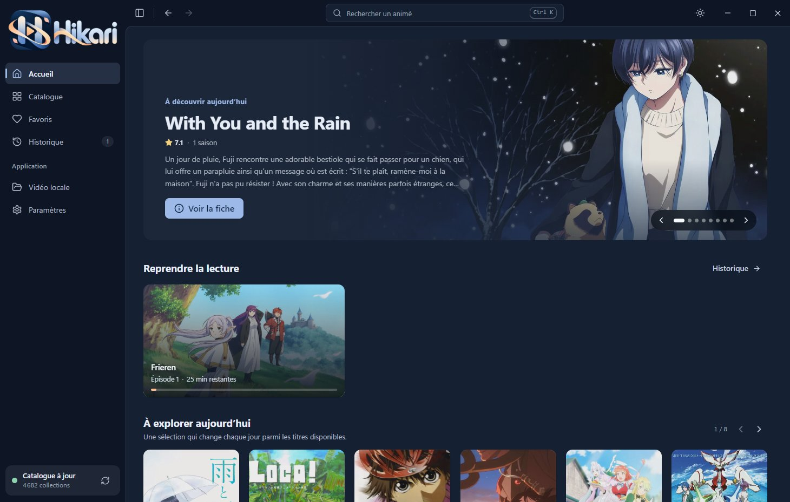
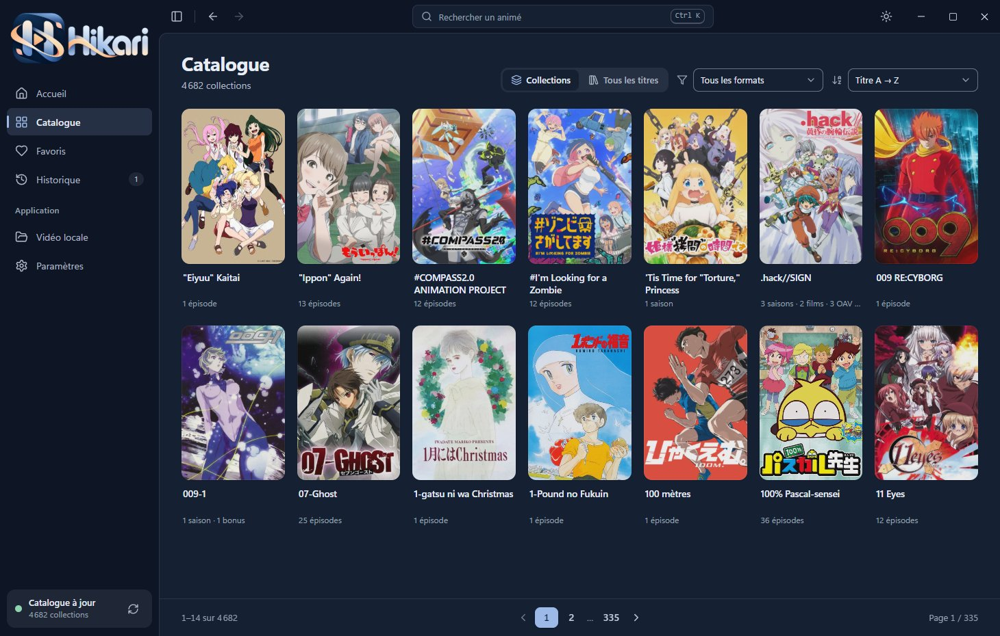
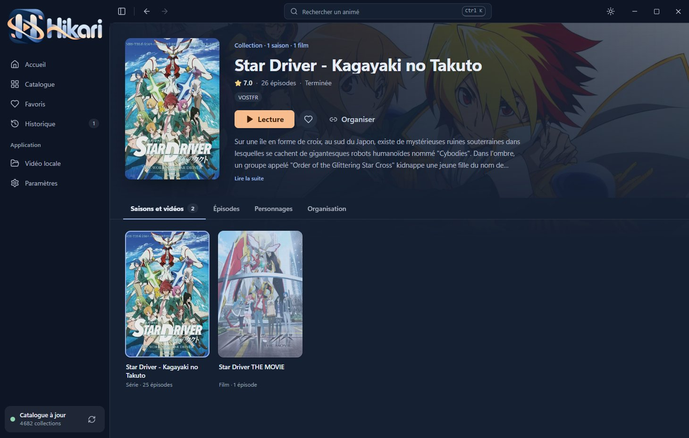
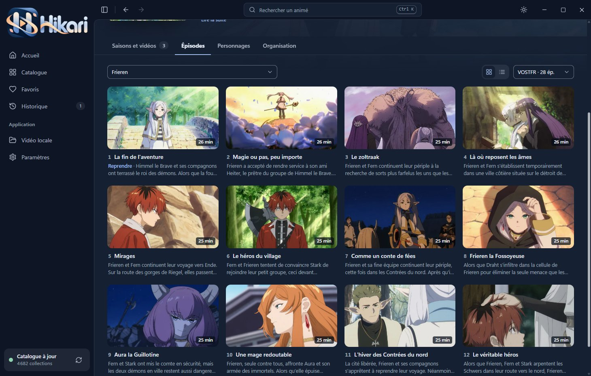
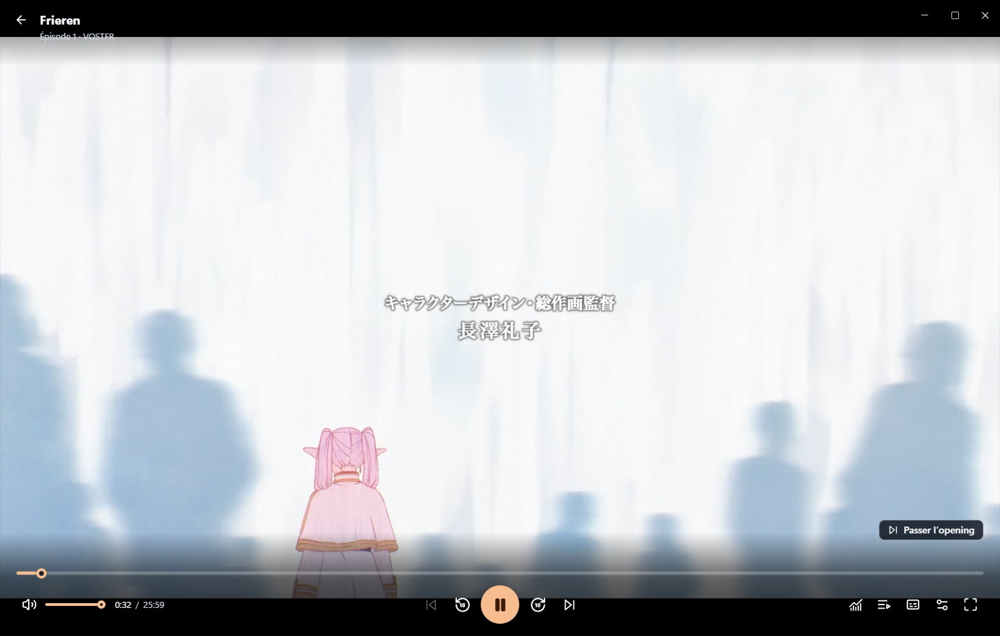
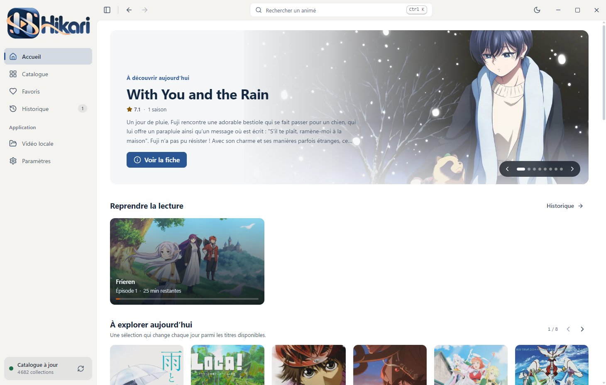
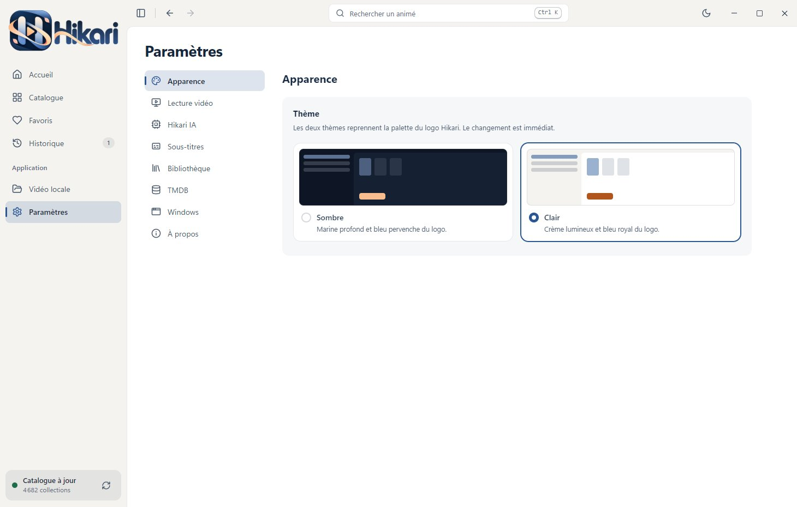

  

<h3 align="center">Votre bibliothèque d’animés sur Windows</h3>

  Parcourez, organisez et regardez vos animés dans une application de bureau rapide et soignée.

  
  
  

---

  

## Ce que fait Hikari

- **Un catalogue clair.** Les saisons, films et épisodes spéciaux d’une même série sont réunis sur une seule fiche, avec affiches, résumés et titres en français quand ils existent.
- **Reprendre là où vous vous êtes arrêté.** Hikari retient la progression de chaque épisode et vous propose de reprendre en un clic depuis l’accueil.
- **Favoris et historique.** Gardez sous la main les séries que vous suivez et retrouvez tout ce que vous avez commencé.
- **Un vrai lecteur intégré.** Lecture fluide dans la fenêtre de l’application, plein écran, choix de la langue et des sous-titres, enchaînement automatique des épisodes, passage des génériques quand l’information est disponible.
- **Une image plus nette.** Amélioration de l’image par intelligence artificielle, en option, sur les cartes graphiques NVIDIA RTX.
- **Des sous-titres à votre goût.** Police, taille, couleur, contour et position réglables, même pendant la lecture.
- **Pensé pour Windows 11.** Thèmes clair et sombre, accès rapide depuis la zone de notification, raccourcis clavier.
- **Toujours à jour.** Les nouvelles versions se téléchargent en arrière-plan et s’installent d’un clic.

## Aperçu

<table>
  <tr>
    <td width="50%">
Le catalogue
</td>
    <td width="50%">
Une série et toutes ses saisons
</td>
  </tr>
  <tr>
    <td>
Les épisodes, avec titres et résumés
</td>
    <td>
Le lecteur intégré
</td>
  </tr>
  <tr>
    <td>
Le thème clair
</td>
    <td>
Les paramètres
</td>
  </tr>
</table>

## Installer

1. Téléchargez **Hikari.exe** depuis la [dernière version](https://github.com/pascal-fortunati/hikari-releases/releases/latest).
2. Placez-le dans le dossier de votre choix, par exemple `Documents\Hikari`, puis lancez-le.
3. Au premier démarrage, Hikari prépare le catalogue et ses images : cela peut prendre quelques minutes.
4. Au moment de la première lecture, Hikari vous propose d’installer son lecteur vidéo depuis les paramètres (environ 70 Mo).

> **Windows affiche « Windows a protégé votre ordinateur » ?** L’application n’est pas encore signée numériquement. Cliquez sur **Informations complémentaires**, puis sur **Exécuter quand même**.

**Configuration requise :** Windows 10 ou 11, 64 bits, et une connexion Internet. L’amélioration d’image par IA nécessite une carte graphique NVIDIA RTX.

## Mises à jour

Hikari vérifie lui-même l’arrivée d’une nouvelle version. Quand elle est prête, un message apparaît dans le menu de gauche : un clic suffit pour l’installer et redémarrer. Vous pouvez aussi lancer une vérification depuis **Paramètres → À propos**.

Chaque version est accompagnée d’un fichier `SHA256SUMS.txt` : Hikari l’utilise pour vérifier que le fichier téléchargé est intact avant de l’installer.

## Raccourcis utiles

| Touche | Action |
|---|---|
| `Ctrl` + `K` | Rechercher un animé |
| `Espace` | Lecture / pause |
| `←` `→` | Reculer / avancer de 10 secondes |
| `F` | Plein écran |
| `M` | Couper le son |

## Bon à savoir

- Hikari n’héberge aucune vidéo. La disponibilité des contenus dépend de services tiers ; utilisez uniquement des contenus pour lesquels vous disposez des autorisations nécessaires.
- Vos favoris, votre historique et vos réglages restent sur votre ordinateur.
- Ce produit utilise l’API TMDB, sans être approuvé ni certifié par TMDB.

Ce dépôt contient les versions publiées de l’application et les sources de son site officiel Next.js.

## Site officiel

Le site présente Hikari, ses captures et ses fonctionnalités. Les téléchargements et le changelog sont synchronisés automatiquement avec les releases GitHub, sans redéploiement à chaque version de l’application.

- [Développement et maintenance du site](docs/SITE.md)
- [Déploiement dans Pushora](docs/DEPLOIEMENT-HIKARI.md)

Pour démarrer le site localement : Node.js 24, `npm ci`, puis `npm run dev`. Ouvrir `http://localhost:43123`.
